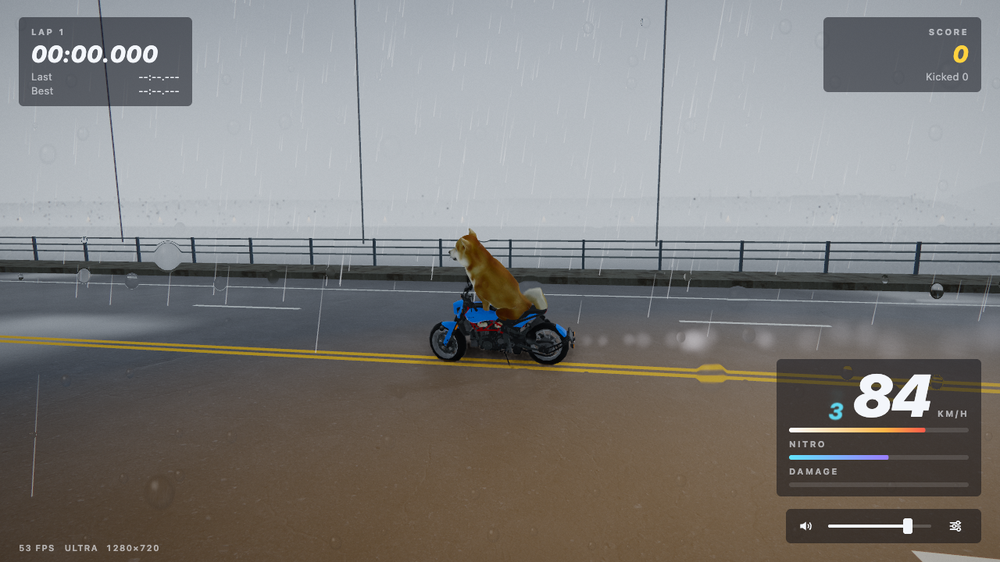
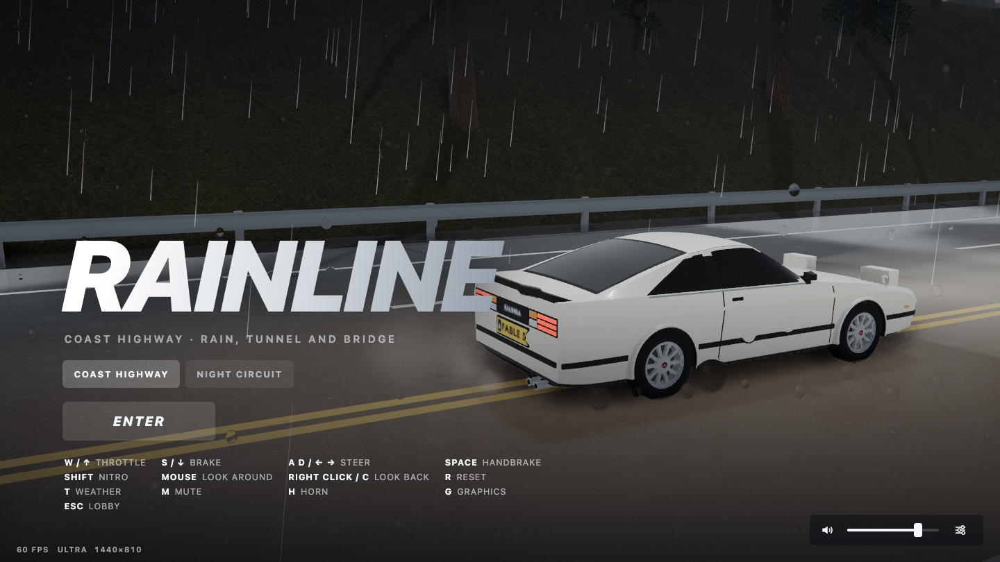
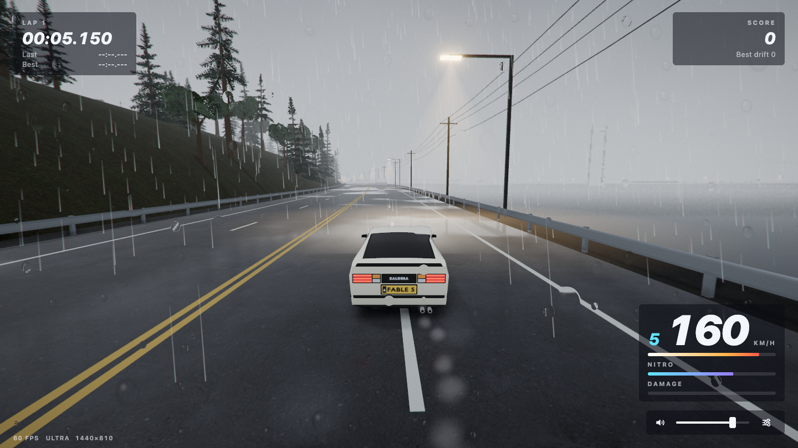
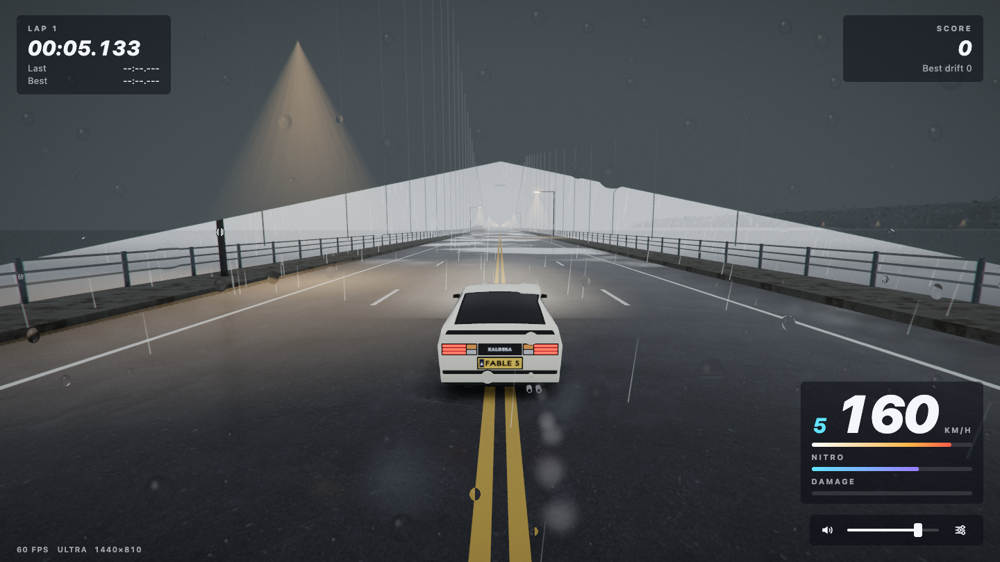
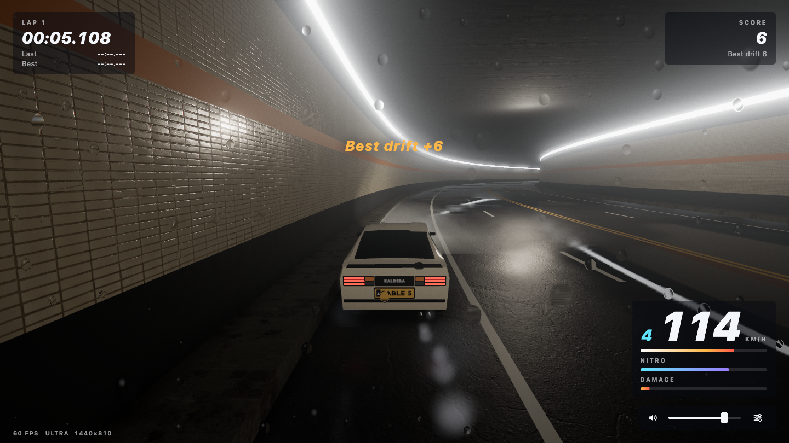
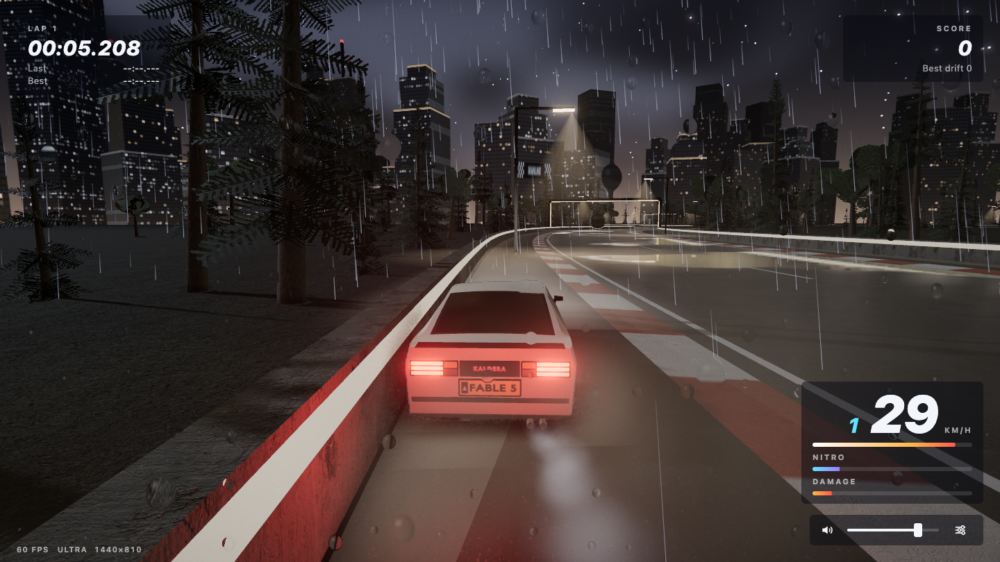
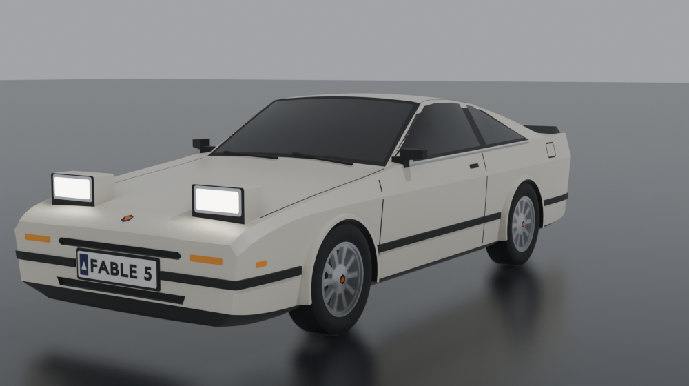
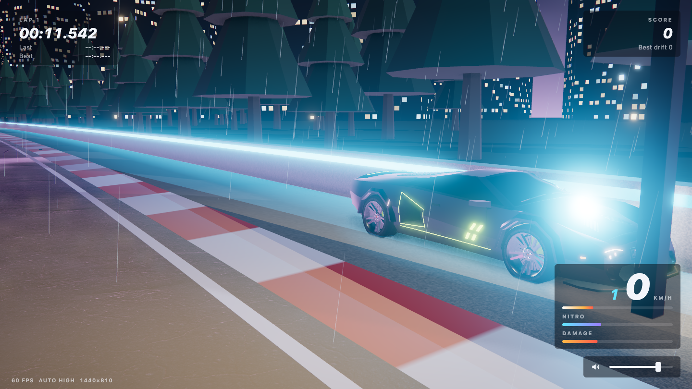

# Rainline

An arcade drifting game in the browser, on Three.js and TypeScript. Two tracks in the rain, one car, and a score for every slide.

**Play it:** https://rainline.openwebarcade.com

Open source under the MIT licence. Every asset in this repository is CC0, CC BY 4.0 or made for the game; see [ASSETS.md](ASSETS.md).

- **Coast Highway** (the default): a 6.4 km loop of mostly straight road under grey daylight, along a wooded coast, through two tiled tunnels and over a suspension bridge.
- **Night Circuit**: a twisty 2.1 km circuit under a city skyline.
- **Beaver Run**: the meme mode. A Shiba Inu on a motorbike rides the coast highway through traffic. Z swipes left and C swipes right; a kicked car, van, truck or bus tumbles off the road in a burst of confetti, knocks over whatever it lands on, and scores. Quick kicks build a combo. On the hosted game fourteen characters line the road, among them a skateboarding granny, a clown doing the chicken dance and a zombie dancing Thriller (see [Private assets](#private-assets)).

Pick the track in the lobby, or open `/?track=coast`, `/?track=city` or `/?track=beaver`.















## Run it

You need Node 22.18 or later.

```bash
npm install
```

```bash
npm run dev
```

Open http://localhost:5183. Click **Enter**, then **Drive**. A plain clone runs fully offline: it makes no request outside its own files.

| Key | Action |
|---|---|
| W / ↑ | Throttle |
| S / ↓ | Brake, then reverse |
| A D / ← → | Steer |
| Space | Handbrake |
| Shift | Nitro |
| Move the mouse | Look around the car; the view swings back behind it after a moment |
| Hold right click or C | Look behind |
| R | Put the car back on the track |
| T | Rain on or off |
| M | Mute or unmute |
| H | Horn |
| G | Next graphics quality: Ultra, High, Medium, Low, Minimum, Auto |
| Esc | Back to the lobby |

A gamepad works too: left stick steers, the triggers are throttle and brake, A is the handbrake, B or X is nitro.

On a phone or tablet, buttons appear while you drive: steer on the left; gas, brake, drift (handbrake) and nitro on the right; kicks above them in Beaver Run; menu and reset at the top left. Touch devices start on Auto graphics.

The volume slider and mute button sit in the bottom right corner, and the setting is remembered.

## How to drift

- **Power slide:** stay on the throttle and hold the steering at full lock. After a moment the tail steps out and the car settles into a slide at about 80 km/h. Ease the steering to straighten.
- **Handbrake turn:** steer and tap Space, then stay on the throttle and hold the slide with the steering.
- **Brake flick:** at speed, turn in and tap the brake.
- **Donut:** from a crawl, full throttle and full lock.

The circuit is 2.1 km with 24 corners and no long straights, so most of a lap is spent sideways.

Sliding fills the nitro bar and scores points. The multiplier climbs the longer one run lasts, linked slides count as one run, and touching a wall loses it.

## Damage

Hitting a wall harder than a brush dents the body where it hit, fills the damage bar and costs a little engine pull. A hard hit also leaves pieces on the track. Crossing the line repairs the car and clears the pieces.



## Frame rate

The game starts on Ultra and stays there. The sliders button beside the volume opens the graphics menu (Ultra, High, Medium, Low, Minimum, Auto), G steps through the same list, and the choice is remembered. The corner of the screen shows frames per second, the tier and the drawn resolution.

The top three tiers draw at the display's native resolution with 4x anti-aliasing and give up ambient occlusion and reflection detail first; only Low and Minimum lower the resolution. Auto steps down only when most frames in a second are slow, so a few hitches from a busy machine do not count, and it goes back up and stops trying if the lower tier was no faster.

## Checks

```bash
npm run typecheck
```

```bash
npm test
```

```bash
npm run build
```

## Private assets

The hosted game plays sounds licensed from Splice and shows a roadside cast of Adobe Mixamo characters in Beaver Run. Their licences allow them inside a game but not as files anyone can download, so they are not in this repository. Every one of those sounds has a CC0 stand-in here under the same name, so a clone plays with full sound; the roadside cast is simply left out.

The originals live in a private repository. With access, clone it into the git-ignored `public/local` folder:

```bash
git clone https://github.com/marginsystems/rainline-assets.git public/local
```

The game reads `local/manifest.json` and loads the files it names in place of the stand-ins (`src/local-assets.ts`). Without the folder it uses the stand-ins and makes no other request.

## Portal build

```bash
npm run build:portal
```

Writes `dist-portal/` and `rainline-portal.zip` for game portals: relative paths, no `public/local/` files, no share tags or links to outside addresses. `tools/portal-check.ts` fails the build if any of those slip in.

## Deploy

```bash
npm run build
```

```bash
npx wrangler deploy
```

`wrangler.jsonc` serves `dist/` as static assets on Cloudflare Workers at rainline.openwebarcade.com. Build with `public/local` in place so the hosted game has the private assets.

## Layout

| Folder | What is in it |
|---|---|
| `sim/` | The rules, with no Three.js and no DOM: the track spline, the car's handling, drift scoring, lap timing, and the Beaver Run traffic and kicks. Fixed 120 Hz step. |
| `src/render/` | Renderer and post-processing: quality tiers, MSAA, ambient occlusion, bloom, the lens pass with its raindrops, the planar reflection for the wet road, the overcast day sky and the night sky. |
| `src/world/` | What is drawn. `venue.ts` lists the tracks; `coast/` builds the highway (road, guardrails, hillside, power lines, tunnels, bridge) and `city-venue.ts` the night circuit (walls, lamps, arches, trees, skyline). Also the car model and its dents. |
| `src/fx/` | Rain, smoke, sparks, nitro flames, skid marks, crash debris. |
| `src/camera/` | The chase camera and the lobby orbit. |
| `src/audio/` | Sound manifest, engine layering, music. |
| `src/hud/` | The lobby and the in-game HUD. |
| `blender/` | `build_car.py`, which generates the car model (`npm run car`). |
| `public/` | Models, textures, the sky, sounds. `public/local/` (git-ignored) holds the private assets when present. |
| `tools/` | `portal-check.ts`, run by `npm run build:portal`. |

Credits and licences for every asset are in [ASSETS.md](ASSETS.md); licence texts are in `licenses/`.

## Licence

The code and the files made for this project are MIT ([LICENSE](LICENSE)). Third-party assets keep their own licences, listed in [ASSETS.md](ASSETS.md).
